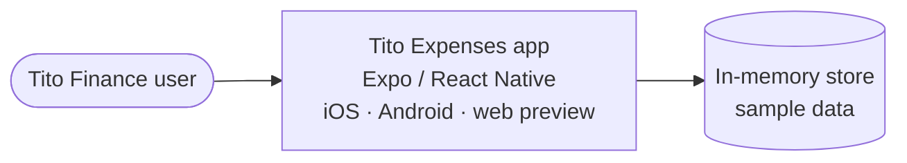
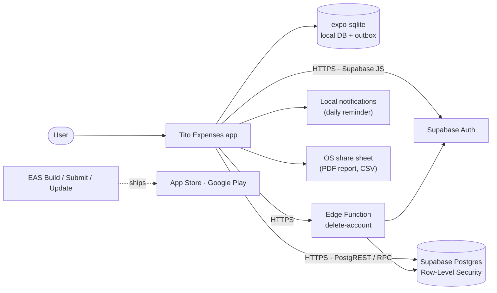
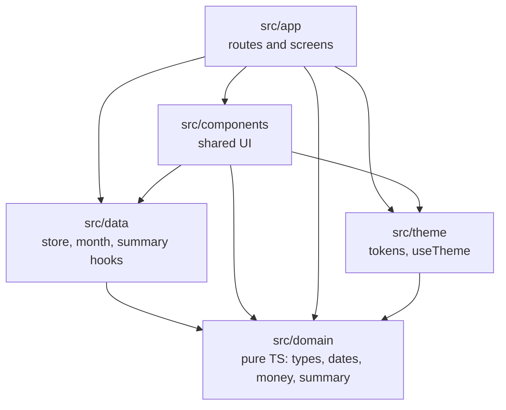
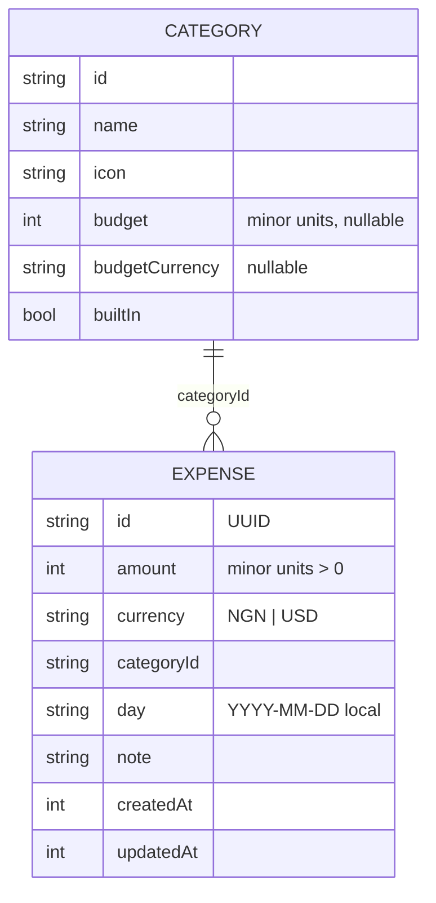
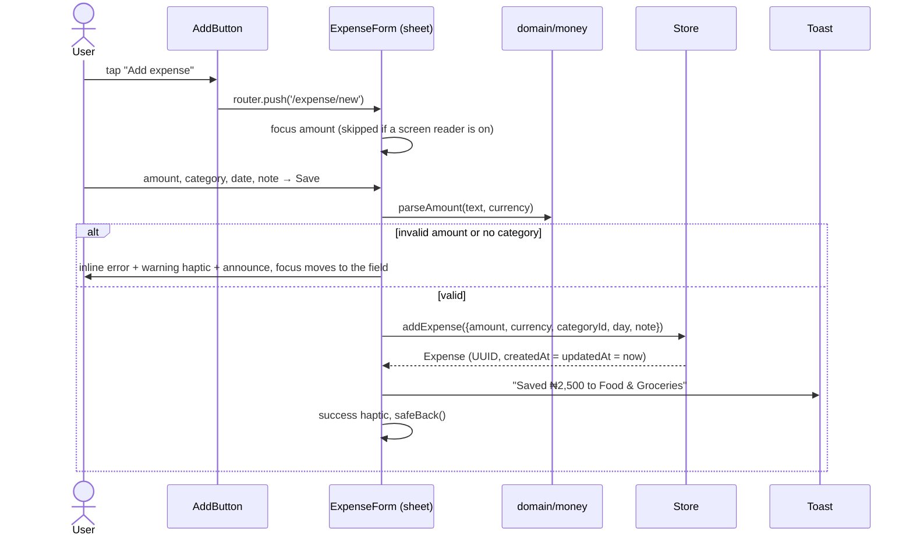
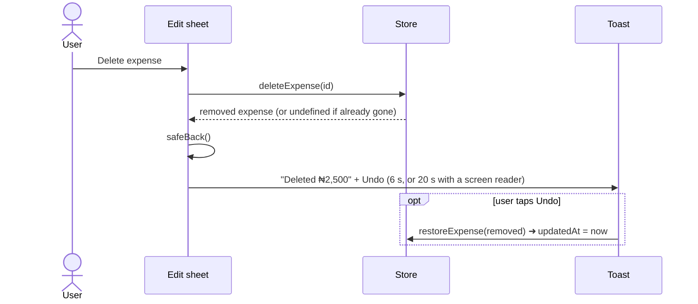
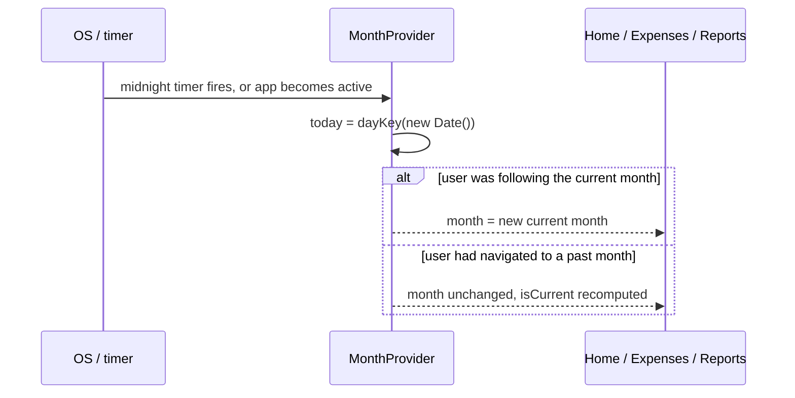
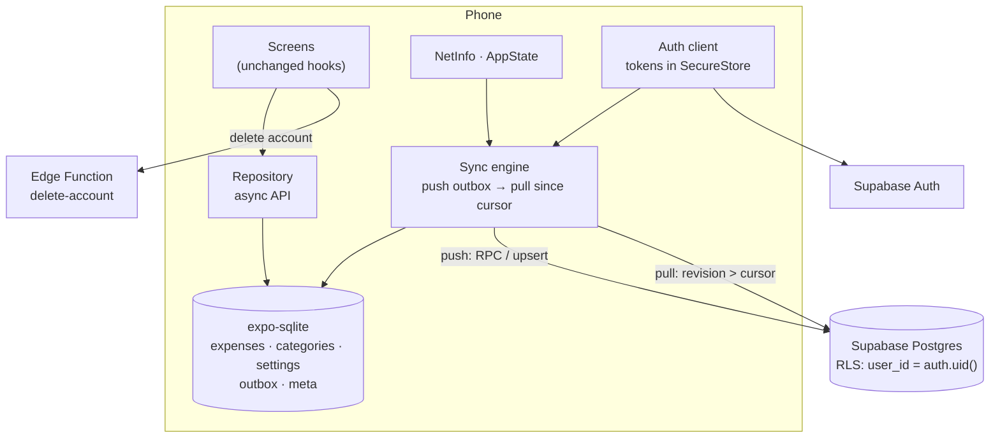

# Architecture: Tito Expenses

How the app is built today (phase 1), why it is built that way, and the target design for phase 2
(real data, sync and a Supabase backend).

| | |
|---|---|
| **Applies to** | `main` at the phase-1 build (screens on sample data) |
| **Last updated** | 2026-11-23 |
| **Scope source** | `proposals/tito-expense-app/PLAN.md` in the Koret Tech repo. Decision D1 = **Track B**: Koret builds its own backend (2026-11-09). |
| **Status key** | **Built**: in the code now. **Planned**: agreed in PLAN.md or `tasks/todo.md`, not built. **Proposed**: this document's recommendation, not yet decided. |

## Contents

1. [System context](#1-system-context)
2. [Technology stack](#2-technology-stack)
3. [Layers and dependency rules](#3-layers-and-dependency-rules)
4. [Runtime composition](#4-runtime-composition)
5. [Navigation](#5-navigation)
6. [Domain model](#6-domain-model)
7. [State and data flow (phase 1)](#7-state-and-data-flow-phase-1)
8. [Key flows](#8-key-flows)
9. [UI system, platforms and accessibility](#9-ui-system-platforms-and-accessibility)
10. [Phase 2 target architecture](#10-phase-2-target-architecture)
11. [Quality gates](#11-quality-gates)
12. [Architecture decisions](#12-architecture-decisions)
13. [Known limitations and open questions](#13-known-limitations-and-open-questions)
14. [Glossary](#14-glossary)

---

## 1. System context

### Today (phase 1, built)

The app is self-contained. Everything runs on the device, in memory, seeded with synthetic data.
Nothing leaves the phone.



### Target (phase 2 and launch, planned)



The old web tracker (`expenses.titofinance.com`) runs on a third-party backend (`aangoo-server`) that
Koret does not control. **The app does not talk to it.** Existing web users start fresh, unless the
owner of that backend provides an export (PLAN.md §7.2, Track B).

---

## 2. Technology stack

| Concern | Choice | Status |
|---|---|---|
| Framework | Expo SDK 58, React Native 0.88, React 19.3 | Built |
| Language | TypeScript 6, `strict: true`, path alias `@/*` → `src/*` | Built |
| Compiler | React Compiler (`experiments.reactCompiler` in `app.json`) | Built |
| Navigation | Expo Router 58: file-based routes, typed routes, `Stack.Protected`, `NativeTabs` | Built |
| State | React Context + `useReducer` (in memory) | Built; replaced in phase 2 |
| Charts | `react-native-svg`, hand-drawn (pace line, bars) | Built |
| Animation | `react-native-reanimated` 4 (toast, Add button), honours Reduce Motion | Built |
| Icons | Tabler (`@tabler/icons-react-native`), stroke 1.75; SF Symbols / Material in the native tab bar | Built |
| Fonts | Manrope (400–800), Fraunces 600, via `@expo-google-fonts` | Built |
| IDs | `expo-crypto` `randomUUID()` (client-generated) | Built |
| Haptics | `expo-haptics` | Built |
| Local database | `expo-sqlite`, with versioned migrations | Planned |
| Backend | Supabase: Postgres, Auth, RLS, an Edge Function | Planned |
| Network state | NetInfo (to know when to flush the outbox) | Planned (PLAN §7.1) |
| Token storage | `expo-secure-store` (Keychain / Keystore) | Planned |
| Notifications | `expo-notifications` (local daily reminder) | Planned |
| PDF and CSV | `expo-print` + `expo-sharing` | Planned |
| Crash reporting | Sentry | Planned (PLAN §7.1) |
| Builds and releases | EAS Build / Submit / Update with a `runtimeVersion` policy | Planned |

---

## 3. Layers and dependency rules



| Layer | Folder | Holds | May import |
|---|---|---|---|
| **Routes** | `src/app/` | Screens and navigators. Each file is a route; `_layout.tsx` files define navigators. | everything below |
| **Components** | `src/components/` | Reusable UI (`Row`, `Button`, `Field`, `T`, `PaceChart`, `Toast`, `ExpenseForm`, `AddButton`, `MonthSwitcher`, …) and small UI helpers (`nav.ts`, `announce.ts`, `use-fab-scroll.ts`) | data, domain, theme |
| **Data** | `src/data/` | State providers and hooks: `store.tsx`, `month.tsx`, `use-summary.ts`, `sample.ts` | domain |
| **Domain** | `src/domain/` | Pure functions and types: `types.ts`, `dates.ts`, `money.ts`, `summary.ts`, `categories.ts` | only other domain files |
| **Theme** | `src/theme/` | `tokens.ts` (palettes, category colours, spacing, radius, type), `use-theme.ts`, `web-focus.ts` | domain types only |

**Rules**

1. **Domain is pure.** No React, no React Native, no `Date.now()` hidden inside calculations (callers
   pass `now` or `today`). This is why `scripts/check-dates.ts` can run it in plain Node under a
   forced timezone.
2. **Screens never touch storage directly.** They read through `useStore()`, `useMonth()` and
   `useSummary()`, and write through `useActions()`. This is the seam phase 2 replaces.
3. **Non-route code stays out of `src/app/`.** Expo Router treats every file there as a screen.
4. **Colours come only from `src/theme/tokens.ts`.** Components ask `useTheme()` for the palette
   (`c`) and never hard-code a hex. Two exceptions exist: the white label on the welcome button and
   the toast's fixed text colours, both covered by the contrast check.

---

## 4. Runtime composition

`src/app/_layout.tsx` is the root. It keeps the splash screen up until the fonts load (or fail), then
mounts the provider tree:

```
GestureHandlerRootView
└─ SafeAreaProvider
   └─ ThemeProvider            (React Navigation theme built from our tokens; light or dark)
      └─ StoreProvider         (expenses, categories, settings, signedIn + actions)
         └─ MonthProvider      (viewed month, current month, local "today")
            └─ ToastProvider   (one snackbar for the whole app, rendered above everything)
               └─ Routes       (Stack with two Stack.Protected groups)
```

The order matters:

- `MonthProvider` sits inside `StoreProvider` so month-aware hooks can read the store.
- `ToastProvider` sits inside both, so a toast's **Undo** can call store actions.
- The toast renders as a sibling after the navigator, so it floats over every screen, including sheets.

`unstable_settings = { anchor: '(tabs)' }` means a cold deep link straight to a sheet (for example
`titoexpenses://expense/new`) still mounts the tabs underneath it. Closing the sheet then lands
somewhere sensible.

---

## 5. Navigation

### Route tree

```
Stack (root)
├─ Protected guard = signedIn
│  ├─ (tabs)                 NativeTabs on iOS/Android · custom TabList on web
│  │  ├─ index      Home
│  │  ├─ expenses   Expenses
│  │  ├─ reports    Reports
│  │  └─ settings   Settings
│  ├─ expense/new            sheet
│  ├─ expense/[id]           sheet
│  ├─ category/[id]          push (header "Edit" button)
│  ├─ category/edit          sheet
│  ├─ categories             push
│  └─ account/delete         push
└─ Protected guard = !signedIn
   ├─ welcome                fade
   ├─ sign-in
   ├─ sign-up
   └─ reset
```

### Design points

- **Auth gating uses `Stack.Protected`, not redirects.** When `signedIn` flips, the screens of the
  other group are removed from history. Once signed out, there is no back gesture into the old
  data. This matters most after account deletion.
- **Sheets.** On iOS and Android these are native `formSheet`s (grabber, one detent at full height).
  The web stack has no form sheet, so the same options choose `card` when `Platform.OS === 'web'`.
- **Tabs are sections, not actions.** Adding an expense is the floating `AddButton`, not a tab
  (DESIGN.md, Layout).
- **Native tab bar vs web.** `(tabs)/_layout.tsx` uses `NativeTabs` (the system tab bar, with SF
  Symbols and Material icons). Automatic content insets are off, because Home's indigo header must
  run under the status bar. Each screen applies its own safe-area padding instead.
  `(tabs)/_layout.web.tsx` is picked automatically for web builds and draws a matching bar with
  `expo-router/ui`.
- **`safeBack()`** (`components/nav.ts`) goes back if it can, and otherwise replaces to `/`. It
  covers a sheet opened from a cold deep link, where there is nothing to go back to.
- **Typed routes** are on, so `router.push({ pathname: '/expense/[id]', params: { id } })` is
  checked at compile time.
- **Screen titles.** Every screen registers a `title` for screen readers and the browser tab, even
  where the visible header is blank (`headerTitle: ''`).

---

## 6. Domain model

All in `src/domain/`. Pure, synchronous, tested by `scripts/check-dates.ts`.

### 6.1 Types (`types.ts`)

```ts
type CurrencyCode = 'NGN' | 'USD';
type MonthKey = `${number}-${string}`;              // "2026-11"     local calendar month
type DayKey   = `${number}-${string}-${string}`;    // "2026-11-23"  local calendar day

type Category = {
  id: string;                     // starter: slug ("food"); custom: UUID
  name: string;
  icon: CategoryIcon;             // one of 16 keys
  budget: number | null;          // monthly, minor units; null = no budget
  budgetCurrency?: CurrencyCode;  // a budget never silently changes currency
  builtIn: boolean;               // starter categories keep their name and icon
};

type Expense = {
  id: string;                     // client-generated UUID, stable across sync
  amount: number;                 // minor units, always > 0
  currency: CurrencyCode;         // stored per expense; never relabelled
  categoryId: string;
  day: DayKey;                    // the local day the money was spent
  note: string;                   // optional, up to 120 characters
  createdAt: number;              // epoch ms
  updatedAt: number;              // epoch ms
};
```



### 6.2 Dates (`dates.ts`)

**The rule:** every day and month key is built from the device's *local* date parts
(`getFullYear`, `getMonth`, `getDate`), never from `toISOString()`, which is UTC.

On the web tracker, `toISOString()` meant that in Lagos (UTC+1):

- "next month" did nothing;
- "previous month" skipped a month (bug B1);
- between midnight and 1 am the default date was yesterday (bug B3).

| Function | Purpose |
|---|---|
| `dayKey(d)`, `monthKey(d)`, `todayKey(now)` | `Date` → key, from local parts |
| `parseDay`, `parseMonth`, `monthOfDay`, `dayOfMonth`, `daysInMonth` | Key arithmetic |
| `addMonths(m, n)` | Built on day 1 at local midnight, which never overflows into a neighbouring month |
| `addDays(d, n)` | Built with the `Date` constructor, so DST changes are safe |
| `monthName`, `monthLabel`, `shortMonth`, `dayLabel`, `shortDay` | English labels: "Today", "Yesterday", "Monday 3 November", "9 Nov". The year is added only when it isn't the current one. |

Keys are fixed-width ISO-like strings, so **comparing them as strings is comparing dates**
(`a < b`, `m > current`). The code relies on this when sorting and clamping.

### 6.3 Money (`money.ts`)

- **Storage:** integer minor units (`₦2,500` → `250000`). Every currency in `CURRENCIES` declares
  `minor: 100`.
- **`formatMoney(minor, currency, { compact?, signed? })`** is hand-rolled rather than `Intl`, so the
  output is identical on Hermes (iOS and Android) and on the web. Rules:
  - grouping commas;
  - decimals only when the amount has them;
  - a true minus sign (`−`) for negative amounts;
  - compact mode gives `₦45k` and `₦1.2m` (and rounds `999,600` up to `₦1m`, never `1000k`).
- **`parseAmount(text, currency)`** turns what the user typed into minor units, or `null`. It accepts:
  - `2500`, `2,500` and `1,250.50`;
  - `.5` and `5.`;
  - decimal commas from comma-decimal phone keyboards: `12,5` → ₦12.50 (never ₦125), and `1.250,50`.

  It rejects ambiguous input (`12.345`, `1,2,3`), zero, and anything that isn't a safe integer.
- **`amountToInput(minor, currency)`** goes back to an editable string for the edit form.

### 6.4 Summaries (`summary.ts`)

**`summarise(expenses, categories, month, currency) → MonthSummary`** makes one pass over the
expenses:

- It skips other months.
- It moves expenses in other currencies to `otherCurrencies`. They are totalled, never converted.
- It skips malformed days (for example `2026-02-31`) so the chart never gets `NaN`.
- An expense whose category no longer exists is counted under **Other** (or the first category).
- It builds `perDay`, then a **cumulative** array (index 0 = day 1). The pace chart draws from this.
- `byCategory` contains only categories with spending, sorted by total, largest first.

**`pace(current, previous, today)`** compares this month with last month at the same day of the
month:

- `day` is today's day of the month when viewing the current month, or the month's last day for a
  past month.
- Last month's figure is read at `min(day, last month's length)`, so 31 March compares with
  28/29 February.
- It returns `null` when last month has no spending. There is nothing to compare against.
- `delta > 0` means spending faster than last month.

**`compareWords(delta, base, currency)`** returns `'same'` when the difference is under the
currency's `sameBelow` floor (₦100 or $1, set in `CURRENCIES`) or under 2% of last month's figure,
whichever is larger. Otherwise it returns `'less'` or
`'more'`. Home and Reports both use it, so they always word comparisons the same way.

**`budgetFor(category, currency)`** returns the budget only when it was set in the currency being
viewed.

### 6.5 Starter categories (`categories.ts`)

These are the twelve categories from the web tracker, in its order, with slug ids: `rent`, `food`,
`transport`, `bills`, `airtime`, `family`, `faith`, `personal`, `health`, `entertainment`,
`shopping`, `other`. Custom categories get UUIDs and can use four more icons: `savings`,
`education`, `gift`, `business`.

---

## 7. State and data flow (phase 1)

### 7.1 Store (`data/store.tsx`)

```ts
type State = {
  expenses: Expense[];
  categories: Category[];
  settings: { currency; reminderOn; reminderTime; firstName; email };
  signedIn: boolean;
};
```

- **A reducer with nine actions:** `add`, `update`, `delete`, `restore`, `upsertCategory`,
  `settings`, `signIn`, `signOut`, `wipe`.
- **Two contexts.** `StateCtx` holds the state and `ActionsCtx` holds the action functions. The
  actions are built once (`useMemo(…, [])`), so their identities never change, and components that
  only *write* never re-render when the data changes.
- **The `latest` ref.** Actions that must answer "did this exist?" read `latest.current` instead of
  a closure, so they never see stale state:
  - `updateExpense` returns `false` when the expense was deleted;
  - `deleteExpense` returns the removed expense so it can be undone.

  `deleteExpense` also updates the ref straight away, so a double tap can't delete twice.
- **Undo** dispatches `restore` with a fresh `updatedAt`. Phase 2 needs this: a restored row must be
  newer than its tombstone, so a sync can't revert it.
- **`wipe`** (account deletion) clears expenses, resets categories to the starter set with no
  budgets, and signs out.

Public hooks:

| Hook | Returns |
|---|---|
| `useStore()` | `State` |
| `useActions()` | `addExpense`, `updateExpense`, `deleteExpense`, `restoreExpense`, `saveCategory`, `updateSettings`, `signIn`, `signOut`, `deleteAccount` |
| `useCategory(id)` | One category, or `undefined` |

### 7.2 Month and "today" (`data/month.tsx`)

`MonthProvider` holds the month being viewed. Home, Expenses and Reports share it, so switching the
month on one tab switches it on all three.

- **`today` stays fresh.** It is recomputed when the app returns to the foreground (`AppState`) and
  by a timer set for one second past the next local midnight. A phone left open across the 1st
  moves into the new month.
- **It follows the current month.** While the user is viewing the current month (`followCurrent`),
  the view rolls forward with the calendar. After they navigate back, it stays on the month they
  chose.
- **Navigation is clamped.** `next()` never goes past the current month.

### 7.3 Derived data (`data/use-summary.ts`)

`useSummary(month)` memoises `summarise()` for the viewed month and the month before, keyed on
`expenses`, `categories`, `month` and the main currency. Screens never add up amounts themselves.
There are two exceptions:

- the Expenses tab's per-day subtotals;
- the category detail's own month totals.

### 7.4 Sample data (`data/sample.ts`)

A seeded linear congruential generator builds synthetic Lagos-style spending, so it looks the same
on every launch:

- two full past months, plus the current month up to today;
- fixed rules: rent on the 1st, bills on fixed days, tithe on Sundays, random food and transport;
- last month scaled 1.12×, so the pace line has something to show;
- one USD expense, to show the "counted separately" behaviour;
- budgets on Food (₦90k), Transport (₦45k) and Airtime (₦6k).

No real person's spending is used.

---

## 8. Key flows

### 8.1 Add an expense



A `busy` ref guards against double-submits. The date stepper can't go past today. On iOS it
announces the new date, because iOS has no live regions.

### 8.2 Delete with Undo



The edit screen keeps the last expense it found in local state, so the sheet doesn't flash "This
expense is no longer here" while it animates away. That empty state is still shown when an
expense really is missing, for example after a deep link to a deleted id (or, in phase 2, one
deleted on another device).

### 8.3 Month rollover



### 8.4 Sign-out and account deletion

- **Sign out:** `signOut()` sets `signedIn = false`. `Stack.Protected` removes every signed-in screen,
  and the app replaces to `/welcome`.
- **Delete account:** the user types `DELETE`. `deleteAccount()` dispatches `wipe` and the app
  replaces to `/welcome`. In phase 1 this is local only. Phase 2 calls the Edge Function first and
  only wipes local data once the server confirms (§10.6).

---

## 9. UI system, platforms and accessibility

### 9.1 Theme

- **Tokens** (`theme/tokens.ts`):
  - `light` and `dark` palettes of the same shape (`Palette`);
  - 16 `categoryColors` light/dark pairs;
  - `space` (4 to 44), `radius` (8, 12, 16, pill);
  - `fonts` and the `type` scale (`total`, `largeTitle`, `title`, `headline`, `body`, `bodyStrong`,
    `sub`, `caption`, `button`);
  - `TARGET`: 44 on iOS and the web, 48 on Android.
- **`useTheme()`** follows the system colour scheme and returns `{ c, scheme }`.
- **`useCategoryColor(icon)`** returns the hue and its disc tint: 12% alpha in light, 18% in dark.
- **Text** goes through `T` (`components/text.tsx`), which applies a `variant`, a `tone` and
  optional tabular figures (`numeric`).
- The design rules behind these tokens are in [DESIGN.md](../DESIGN.md). Light and dark are
  designed as pairs. In dark mode, for example, the primary button becomes periwinkle with ink text,
  because a dark indigo button would disappear on the indigo-black ground.

### 9.2 Charts

- **`PaceChart`** (`components/pace-chart.tsx`) is drawn with `react-native-svg`. This month is a
  monotone cubic line (no overshoot below zero or past the real values) with a gradient fill. Last
  month is a dashed ghost line. A gold dot marks today. The whole chart has one
  `accessibilityLabel` that states the numbers in words.
- **Reports month-by-month bars** are plain `View`s sized as a percentage of the largest month. Each
  bar is a button that selects its month.
- **Category colour never goes into a chart** (the Disc-Only Rule). Ranked rows carry the comparison.

### 9.3 Platform differences

| Area | iOS | Android | Web |
|---|---|---|---|
| Tab bar | `NativeTabs`, SF Symbols | `NativeTabs`, Material icons | `_layout.web.tsx`, Tabler icons |
| Sheets | `formSheet` with grabber | `formSheet` | Full-screen `card` |
| Touch target | 44 pt | 48 dp | 44 px |
| Announcements | `announceForAccessibility` (no live regions) | Live regions | `aria-live`, and focus moves to the field |
| Focus ring | System | System | `theme/web-focus.ts` adds a `:focus-visible` outline (WCAG 2.4.7) |
| Switch colours | `trackColor` | `trackColor` | Also needs `activeTrackColor`/`activeThumbColor` |
| Toast offset | Tab bar 49 | Tab bar 80 | Tab bar 62 |
| Back | Swipe | Predictive back (`predictiveBackGestureEnabled`) | Browser back |

Tab screens stay mounted, so a plain `<StatusBar>` would leave whichever tab mounted last in charge.
`FocusStatusBar` renders the status bar only for the focused screen. Home uses light content on
indigo, and the other tabs follow the colour scheme.

### 9.4 Accessibility architecture

- **Errors:** `announceError(message, ref)` (`components/announce.ts`) speaks the first error and
  moves accessibility focus to its field. Inline errors also sit in polite live regions.
- **Toasts:** announced on every platform. One with an action stays 20 s when a screen reader is on,
  so Undo can be reached.
- **Controls with roles:**
  - currency and category pickers are `radiogroup`s of `radio`s;
  - the date stepper is `adjustable`, with increment and decrement actions;
  - section headers have the `header` role.
- **Autofocus is skipped with a screen reader on.** The add sheet only opens the keyboard when no
  screen reader is running, so screen-reader users hear the heading first.
- **Search results** are announced as a count, debounced through `useDeferredValue` plus a 600 ms
  timer.
- **Text scaling** follows the OS. `maxFontSizeMultiplier` caps it at 2× for all text and fields,
  1.6× for category tile names and 1.5× for the amount input. Totals shrink to fit, down to 60%.
- **Motion:** Reanimated animations use `ReduceMotion.System`.
- **Contrast:** `npm run check:contrast` checks 82 pairs in light and dark (text at 4.5:1,
  non-text at 3:1).

### 9.5 Floating Add button

`useFabScroll()` turns scroll position into two flags:

- **`compact`:** after 120 px of scroll, the "+ Add expense" pill shrinks to a round "+".
- **`hidden`:** the button hides while scrolling down, so it never covers the amounts being read,
  and comes back on any scroll up.

Lists reserve `120 + safe-area` bottom padding, so the last row is never hidden.

---

## 10. Phase 2 target architecture

> **Status:** planned. The bullet points in `tasks/todo.md` (Phase 2) and PLAN.md §7.1 are agreed.
> The schema, the sync protocol on Supabase and the module layout below are **proposed**, adapting
> PLAN.md's sync design to Track B. Review them before building.

### 10.1 Goals and constraints

From PLAN.md §5.6 and the MVP definition:

- **Offline first.** Logging never waits for the network. Writes queue on the phone and sync later
  without duplicates.
- **Instant month screen.** It renders from local data, then refreshes.
- **The server is the source of truth.** Conflicts resolve as last edit wins (one user, few
  devices). A delete always wins.
- **The offline test must pass:** add 5 expenses offline, kill the app, go online, and exactly 5 sync.
- **The deletion test must pass:** the data is gone on the server.

### 10.2 Shape



**SQLite is the only thing screens read from.** Network responses are written into SQLite, never
shown directly, so there are never two caches that disagree (PLAN.md §7.1).

### 10.3 Store API changes (from `tasks/todo.md`)

- **Mutators become async.** They return promises. Toasts and navigation happen after the local
  write resolves.
- **The store exposes `ready` and `error`.** Screens wait for `ready` and show an error state on
  `error`.
- **Soft deletes with tombstones** (`deletedAt`). Undo restores with a newer `updatedAt` (and a new
  `version`), so a sync can't bring the delete back.
- **Aggregates move to SQL** (month totals, by category, by day), with an index on `day`, instead of
  JavaScript over every row. `summarise()` stays the reference implementation. A check should
  confirm that the SQL and JavaScript give the same totals.
- **Rows read from SQLite or CSV are validated** through `toDayKey()` and `toMonthKey()` (branded
  types) before they enter the domain.
- **Account deletion and auth** get real error paths.

The hook names (`useStore`, `useActions`, `useSummary`, `useMonth`) stay the same, so screens change
only where they now await a result.

### 10.4 Proposed server schema (Supabase)

```sql
-- Proposed. Money is bigint minor units; day is a calendar date (no time zone).
create table profiles (
  id               uuid primary key references auth.users on delete cascade,
  first_name       text not null check (char_length(first_name) between 1 and 60),
  currency         text not null default 'NGN' check (currency in ('NGN','USD')),
  reminder_on      boolean not null default true,
  reminder_time    time not null default '20:00',
  marketing_opt_in boolean not null default false,
  created_at       timestamptz not null default now(),
  updated_at       timestamptz not null default now()
);

create table categories (
  user_id         uuid not null references auth.users on delete cascade,
  id              text not null,                       -- slug for starters, UUID for custom
  name            text not null check (char_length(name) between 1 and 40),
  icon            text not null,
  budget          bigint check (budget > 0),
  budget_currency text check (budget_currency in ('NGN','USD')),
  built_in        boolean not null default false,
  version         int not null default 1,
  revision        bigint not null,                     -- set by trigger from a sequence
  deleted_at      timestamptz,
  primary key (user_id, id)
);

create table expenses (
  id          uuid primary key,                        -- client-generated; makes retries idempotent
  user_id     uuid not null references auth.users on delete cascade,
  amount      bigint not null check (amount > 0 and amount < 100000000000),
  currency    text not null check (currency in ('NGN','USD')),
  category_id text not null,
  day         date not null,
  note        text not null default '' check (char_length(note) <= 120),
  created_at  timestamptz not null,
  updated_at  timestamptz not null,
  version     int not null default 1,
  revision    bigint not null,
  deleted_at  timestamptz
);
create index on expenses (user_id, revision);
create index on expenses (user_id, day) where deleted_at is null;
```

- **RLS:** on every table, `using (user_id = auth.uid())` and `with check (user_id = auth.uid())`.
  Before launch, run a two-account test: account A must not be able to read or change account B's
  rows (PLAN.md §9).
- **`revision`** comes from one global sequence, assigned by a `before insert or update` trigger.
  **The server owns time.** Sync never trusts phone clocks, so a phone set to the wrong date can't
  skip or overwrite rows.
- **`day` is a `date`, never a `timestamptz`.** It is the user's local calendar day, exactly as the
  app's `DayKey`.

### 10.5 Proposed sync protocol

1. **Local write.** The app writes the row to SQLite and appends `{entity, op, id, payload,
   baseVersion}` to `outbox` in the same transaction. The UI updates from SQLite straight away.
2. **Coalesce before sending.**
   - Create then edit becomes one create.
   - Create then delete, before a sync, sends nothing.
   - Several edits become the last one.
3. **Push** whenever there is a network connection, the app comes to the foreground, or after a
   write (debounced). The app calls one RPC, for example `push_changes(jsonb)`, that upserts by
   `id`:
   - **Create** is idempotent: on a conflict with the same `id`, nothing changes.
   - **Edit** carries `baseVersion`. On a mismatch, the server copy wins and the user is told.
   - **Edit on a deleted row** is rejected (delete wins), and the app drops the edit.
4. **Pull:** `select … where revision > :cursor order by revision`, including tombstones. The
   app applies the rows to SQLite and stores the new cursor in `meta`.
5. **Old cursor.** If a cursor is older than the tombstone retention window, the server answers
   "full resync" and the app reloads everything.
6. **Auth during sync.** Only one token refresh runs at a time. Signing out with unsynced writes
   warns the user first. The local database is **per user** (one file per user id), so a second
   account never sees the first one's data.

### 10.6 Accounts

- **Supabase Auth** (email and password) handles sign up, sign in, password reset
  (`resetPasswordForEmail` with a deep link back to the app) and token refresh. Sessions are stored
  with `expo-secure-store`.
- **Account deletion** (required by Apple guideline 5.1.1(v) and by Google Play):
  1. The app calls the `delete-account` Edge Function with the user's JWT.
  2. The function, using the service role, deletes the `auth.users` row. Data is erased by
     `on delete cascade`.
  3. Only after a success does the app wipe its local database and sign out.
  4. On failure, the button resets and the screen says why.

  Google Play also needs a **web page for deletion requests** (PLAN.md §5.1, A5).

### 10.7 Other planned modules

| Feature | Approach |
|---|---|
| Daily reminder | `expo-notifications`: local, inexact scheduling (Android 14+ blocks exact alarms). Permission is asked when the user turns the reminder on. No server is involved. |
| Report as PDF | `expo-print` renders HTML built from `MonthSummary`; `expo-sharing` opens the share sheet. |
| CSV export | Built from SQLite; each row carries its own currency (fixes the web's bug B8); shared through the share sheet. |
| Crash reporting | Sentry, with no PII and no amounts. |
| Force update | A minimum supported app version, checked on launch (PLAN.md §7.2 `app/config`). |

### 10.8 Environments and release (planned)

- **EAS profiles:**
  - `development`: a dev client, needed once a native module outside Expo Go is added;
  - `preview`: TestFlight and Play internal testing, against a **staging** Supabase project with no
    real users;
  - `production`.
- **Over-the-air updates** use a `runtimeVersion` policy, so an update only reaches compatible builds.
  OTA is for fixes only. Apple guideline 2.5.2 doesn't allow new features over the air.
- **Android:** `allowBackup` excludes the database and tokens.
- **Still needed in `app.json`:** `ios.bundleIdentifier` and `android.package`. These wait on
  decision D3 (PLAN.md recommends `com.titofinance.expenses`).

---

## 11. Quality gates

| Gate | Command | Guards |
|---|---|---|
| Types | `npm run typecheck` | Strict TS, typed routes |
| Lint | `npm run lint` | Expo ESLint rules, hooks rules |
| Domain | `npm run check:dates` | Local-calendar month/day maths in `Africa/Lagos`; DST; money format and parse; summaries (unknown category, malformed day, other currency) |
| Contrast | `npm run check:contrast` | WCAG AA for 82 text and non-text pairs in light and dark |
| Dependencies | `npx expo-doctor` | SDK 58 compatibility |
| Visual | Web build at 390 × 844, light and dark | Layout and states |
| Devices | Expo Go on a real iPhone and Android phone | Safe areas, keyboard, VoiceOver/TalkBack, 200% text (checklist in `tasks/todo.md`) |

`scripts/check-dates.ts` runs the real domain source in plain Node:

- Node strips the TypeScript types itself.
- `scripts/ts-resolve.mjs` adds the `.ts` extension to relative imports.
- The script sets `TZ=Africa/Lagos` before anything reads the clock.

So nothing is compiled or mocked.

---

## 12. Architecture decisions

| # | Decision | Why | Alternatives rejected |
|---|---|---|---|
| AD1 | **Native app with Expo**, not a wrapped website | Offline use, notifications, store requirements, native feel | WebView wrapper of the web tracker (PLAN.md §2) |
| AD2 | **Track B: own Supabase backend**, fresh start for users | No access to `aangoo-server`; Supabase provides auth, reset, refresh and RLS | Extending `aangoo-server` (Track A) |
| AD3 | **Integer minor units plus a currency on every expense** | Fixes bug B2 (currency relabelling); no float errors | Floats; one global display currency |
| AD4 | **Local calendar string keys** (`DayKey`, `MonthKey`) and an in-house `dates.ts` | Fixes bugs B1 and B3; string compare = date compare; small and tested in Lagos time | `Date` objects throughout; `toISOString()`; date-fns, which PLAN.md §7.1 suggested. Not needed: the module is ~90 lines and covered by `check:dates`. |
| AD5 | **Hand-rolled `formatMoney`** instead of `Intl.NumberFormat` | Identical output on Hermes and the web | `Intl` (output differs by engine and locale data) |
| AD6 | **Client-generated UUIDs** for expenses | Offline creation without server ids; idempotent retries | Server integer ids (as on the web) |
| AD7 | **Charts with `react-native-svg`**, not Victory Native/Skia | Two simple charts; Skia needs extra WebAssembly setup for the web build | Victory Native (Skia), suggested in PLAN.md §7.1 |
| AD8 | **Context + reducer** for phase-1 state, behind hooks | Smallest thing that works for sample data; the hook boundary keeps the phase-2 swap local | Redux, Zustand, TanStack Query in phase 1 |
| AD9 | **`Stack.Protected`** for auth gating | No back gesture into signed-out data | Redirects in `useEffect` |
| AD10 | **System tab bar (`NativeTabs`)** on iOS and Android, custom bar on the web | Native look, feel and behaviour; the native tab view has no web form | A JS tab bar everywhere |
| AD11 | **Brand: Tito indigo `#272c77`**, Manrope + Fraunces; JetBrains Mono dropped | PRODUCT.md brand commitments; amounts use Manrope's tabular figures | The web tracker's monospace amounts |
| AD12 | **SQLite as the only read source in phase 2**, with an outbox | Offline first, instant screens, one cache | Reading straight from the network; two caches |

---

## 13. Known limitations and open questions

**Phase 1 limitations (by design)**

- Data is in memory and reseeded on every launch. Nothing persists.
- Auth, reset, delete account, PDF, CSV, the reminder and the privacy policy are UI stubs (see the
  README).
- `summarise()` scans every expense, and Reports calls it up to six times for the month-by-month
  bars. This is fine for sample data. Phase 2 moves it to SQL.
- Only NGN and USD exist. PLAN.md §5.5 lists NGN, USD, EUR, GBP and CAD for settings.
- Forms use local state and inline checks. PLAN.md §7.1 suggests react-hook-form + Zod. Decide
  before phase 2 whether the extra forms justify it.
- Toast offsets assume the system's default tab bar heights. Confirm them on devices.
- There is no unit-test runner. Domain checks are assertions in a script.

**Open questions**

| # | Question | Owner |
|---|---|---|
| Q1 | Does Mr Tito approve the phase-1 screens? This gates phase 2. | Tito Finance |
| Q2 | App name and bundle id (D3) | Tito Finance + Koret |
| Q3 | Whose Apple and Google developer accounts (D2)? An organisation account needs a D-U-N-S number. | Tito Finance |
| Q4 | Supabase region and plan; staging project | Koret |
| Q5 | Is the sync protocol in §10.5 confirmed, including the tombstone retention window? | Koret |
| Q6 | Which currencies at launch? | Tito Finance |
| Q7 | Analytics at launch (PostHog anonymous, or none)? | Tito Finance + Koret |

---

## 14. Glossary

| Term | Meaning |
|---|---|
| **Minor units** | The smallest unit of a currency: kobo for NGN, cents for USD. ₦1 = 100 kobo. |
| **DayKey / MonthKey** | `"YYYY-MM-DD"` / `"YYYY-MM"` strings in the user's local calendar |
| **Main currency** | The currency totals are shown in (Settings → Money) |
| **Pace line** | Home's chart: cumulative spending this month vs last month to the same day |
| **Outbox** | (Phase 2) A local queue of writes waiting to be sent to the server |
| **Tombstone** | (Phase 2) A soft-deleted row kept so other devices learn about the delete |
| **Revision / cursor** | (Phase 2) A server-issued, ever-increasing change number, and the last one a device has pulled |
| **Sheet** | A modal screen that slides up (native form sheet; a card on the web) |
| **Track B** | Decision D1: Koret builds and owns a new backend rather than extending `aangoo-server` |
| **B1–B9** | Defects found in the old web tracker (PLAN.md §1.6) |
